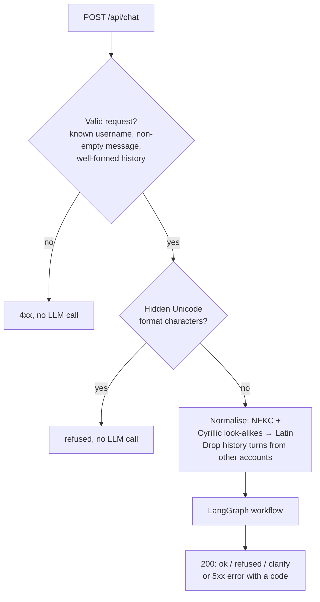
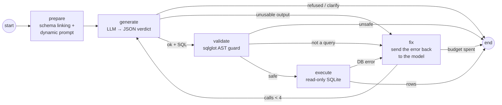

# Architecture

SouthCity Text-to-SQL turns a question in Indonesian (or mixed Indonesian/English) into one read-only SQL query, runs it against the property ERP data the current user is allowed to see, and returns the answer with the rows and the SQL.

The stack is FastAPI, LangGraph and LangChain, an OpenRouter model, sqlglot and SQLite. It is deployed on Vercel.

## Components

| Module | Responsibility |
|---|---|
| `app/main.py` | HTTP layer: request validation (Pydantic), input normalisation, the history filter, and mapping errors to HTTP replies. Serves the demo page. |
| `app/agent.py` | The LangGraph workflow: prepare → generate → validate → execute, with a self-correction loop. |
| `app/prompts.py` | The system prompt: business formulas, terminology, and the policy for `ok`, `refused` and `clarify`. |
| `app/llm.py` | The chat model (OpenRouter through LangChain's `ChatOpenAI`), fallback models, and token and cost accounting. |
| `app/guard.py` | The sqlglot AST guard. A query must be exactly one `SELECT` over the known business tables. |
| `app/db.py` | Builds one SQLite database per badge at startup, runs read-only connections, executes queries, and links the schema. |
| `app/errors.py` | `ServiceError` and the error-code table: HTTP status and the message shown to the user. |
| `public/index.html` | Demo page with an account switcher (`sales_bambang`, `sales_dewi`, `sales_reza`, `finance_hendra`). |

## Request flow



### The LangGraph workflow



1. **prepare (dynamic prompting with schema linking).** The prompt is built per request from the user's own database. It lists the tables and columns, the allowed values parsed from the DDL comments (for example `Tower` → `'Tower A', 'Tower B'`), and the contracts, customers and units this badge can access. Conversation history is added as earlier turns.
2. **generate (query generation).** The model returns one JSON object, `{"status": "ok|refused|clarify", "sql": "...", "answer": "..."}`. The model decides `refused` and `clarify` from the policy in the prompt. There is no keyword routing.
3. **validate.** The SQL goes through the AST guard (see below). An unsafe query ends the run with `refused`. Something that does not parse as a query goes to `fix`.
4. **execute.** The query runs on a read-only connection with a 5-second deadline and a 200-row cap.
5. **fix (self-healing loop).** A parse error, a database error or an unusable model reply is sent back to the model as the next user turn: "SQL gagal: \<error\>. Perbaiki…". The model then tries again. There are at most 4 LLM calls per request, which is the first try plus up to 3 corrections. When the budget runs out the request fails cleanly with `sql_failed` or `llm_bad_output`.

The answer text is assembled from the model's one-line note plus the rows, so numbers in the answer always come from the database, not from the model.

## Security

The design never relies on the model behaving correctly. Each layer below holds even if the model is fully compromised by a prompt injection.

### 1. Data-level RBAC

At startup `db.build()` writes one SQLite file per badge from `schema.sql`:

| Badge | What its database holds |
|---|---|
| Sales (`sales_bambang` → agent 101, etc.) | All `Units` (inventory is public). Only that agent's `Sales_Contracts`, with their schedules, payments and penalties. Payment method, receipt number and bank reference are blanked. |
| Finance (and any non-Sales role) | All business tables. |
| Everyone | `System_Users` is dropped. `CustomerNIK` is masked to the last 4 digits. |

The badge comes from the `username` field and is looked up in `System_Users`. Any `role` or `agent_id` fields in the request body are ignored. Because rows that are not the user's are not in the file at all, SQL that forgets `WHERE SalesAgentID = …` still cannot return another agent's data, and neither can averages or totals that would otherwise reveal them.

### 2. AST guard (sqlglot)

Before anything touches the database, `guard.check()` parses the SQL and returns a single verdict:

- **unsafe → refused:** more than one statement, or any `INSERT`, `UPDATE`, `DELETE`, `DROP`, `CREATE`, `ALTER`, `MERGE`, `TRUNCATE`, `PRAGMA`, `ATTACH`, `DETACH` or unknown command node anywhere in the tree, or any table outside the five business tables (and CTEs).
- **invalid → fix loop:** the SQL does not parse, or is not a query.
- **ok → execute.**

This is a parse-tree check, not a regex or substring check, so `SELECT 1; DELETE FROM Units` and DML hidden inside comments or CTEs are both caught.

### 3. Read-only database access

Connections are opened with `mode=ro` and `PRAGMA query_only = ON`. A progress handler aborts any query that runs longer than 5 seconds, which stops runaway cross joins. At most 200 rows are returned.

### 4. Prompt-injection policy

The system prompt tells the model to refuse:
- destructive commands, even when they are attached to a legitimate question (the safe half is not answered either);
- role-escalation and "debug mode" claims;
- requests for accounts, passwords, system instructions, connection strings or the table list;
- questions where every named customer or unit is outside the user's scope;
- bulk export of personal data.

Mixed questions are answered for the allowed part only. Ambiguous questions get `clarify` rather than a guessed query.

### 5. Input hygiene in the HTTP layer

- Unicode format characters, such as tag-character smuggling, are refused before the LLM is called.
- Cyrillic look-alike letters are normalised to Latin, so `Sіti` matches `Siti`.
- History turns whose `username` differs from the current badge are dropped, so context from another account is never reused. Only `user` and `assistant` roles are accepted, and history is trimmed to the last 6 turns.
- Bodies over 256 KB and messages over 4,000 characters are rejected.

### 6. No internal details in replies

Every error comes back as JSON, `{"status": "error", "answer": "<friendly text>", "error": {"code": …}}`, with no stack traces, SQL errors, provider names or keys.

| Code | HTTP | Cause |
|---|---|---|
| `bad_request` | 400 / 404 / 405 / 413 / 422 | Invalid request (never reaches the LLM) |
| `llm_timeout` | 504 | The model did not answer in time (20 s timeout, one SDK retry) |
| `llm_rate_limited` | 429 + `Retry-After` | Provider rate limit |
| `llm_unavailable` | 502 | Other provider errors |
| `llm_bad_output` | 502 | The model never produced a usable JSON verdict in 4 calls |
| `sql_failed` | 502 | The SQL still failed after self-correction |
| `db_unavailable` | 503 | The database could not be opened |

## Model and cost

- **Model:** the default is `nvidia/nemotron-3-ultra-550b-a55b:free` on OpenRouter, with `nvidia/nemotron-3.5-super-vl:free` as a fallback through OpenRouter's `models` list. Set them with `LLM_MODEL` and `LLM_FALLBACK_MODELS`. Any OpenAI-compatible endpoint works through `LLM_BASE_URL`.
- **Usage:** every reply carries `usage` (`llm_calls`, tokens and `cost_usd`), summed over all LLM calls for the request. Cost comes from OpenRouter's `usage.cost`, which is 0 on free models.
- **Typical cost:** one LLM call of about 2–4k prompt tokens. Refusals and clarifications take a single call.

## Deployment (Vercel)

- `pyproject.toml` sets `[tool.vercel] entrypoint = "app.main:app"`, and `.python-version` pins Python 3.12.
- The per-badge databases are rebuilt in `/tmp` at each cold start from `schema.sql`. This takes milliseconds, because the data is the seed data. A production deployment would point `db.py` at a real database with per-role views or row-level security instead.
- `public/index.html` is served by the Vercel CDN at `/`.
- Required environment variable: `OPENROUTER_API_KEY`. See `.env.example`.

Local run:

```bash
pip install -r requirements.txt
export OPENROUTER_API_KEY=sk-or-...
uvicorn app.main:app --port 8000      # demo page at http://localhost:8000
API_BASE_URL=http://localhost:8000 pytest
```

## Known limits

- **Prompt tuning:** the prompt rules were tuned and checked against the test suite with Claude Sonnet 4.6, and free models may follow them less reliably.
- **Auditor role:** `auditor_maya` currently gets the same access as Finance, because the brief does not define the Auditor's scope.
- **Fault injection:** the test-only fault-injection hooks were removed for production, so the fault tests in `tests/test_failures.py` skip themselves.
